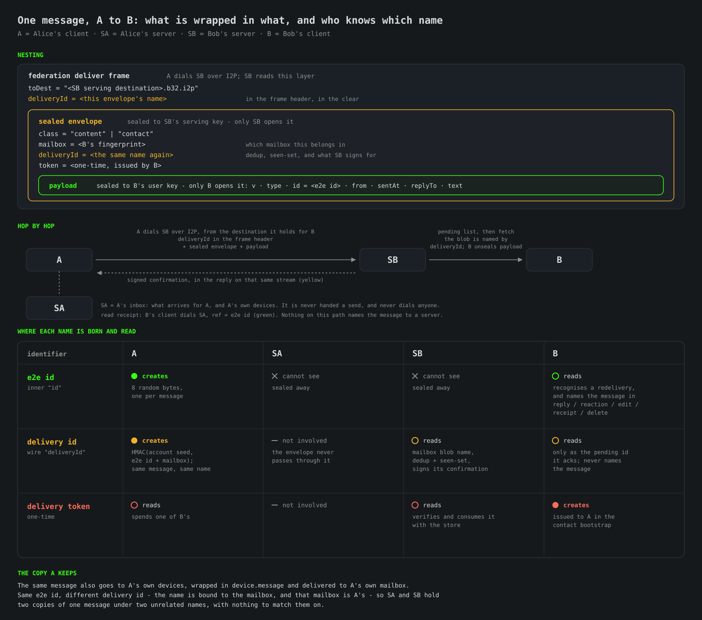

# Messages & Content Types

Status: design draft (decided direction).

## Types

A message says what it is, and the type decides what the other side does with
it - never the file name, and never a mime the sender wrote:

| `type` | What it carries | What the recipient does |
|---|---|---|
| `text` | the text | shows it |
| `file` | a transfer's metadata (name, size, sha256, mime) | offers to fetch it; the bytes travel client to client |
| `image` | the picture itself, bytes in the envelope | decodes it, keeps it in the account, draws it |
| `voice` | Opus audio, bytes in the envelope | keeps it in the account, plays it on a press |
| `contact.request`, `reaction`, `receipt`, `call.*`, `device.*` | as their names say | as documented elsewhere |

`image` carries the picture **inside the message**: there is no announcement and
nothing to request, so it arrives once, with the message, and it arrives even if
the sender goes offline the moment after sending - the mailbox holds it like any
other message. The sender shrinks it first (long edge 1600, re-encoded, at most
256 KiB) so that its base64 and the envelope around it stay inside the 512 KiB
message limit.

Before it is drawn it must decode as an image; a decoder that refuses it is the
answer. Such a message is not quietly turned back into a file card - the bubble
says it is broken, because a fallback would be the client second-guessing what it
was handed. The bytes live in the account database, encrypted with everything
else, and "Save as" is how they leave it.

A `file` is the other path and keeps the announcement: the metadata travels in
the message, the bytes travel client to client on demand, and nothing is bounded
but patience.

The message that announces a transfer is a small message like any other: the
progress bar belongs to the transfer that follows it, not to the announcement.

## Encoding

The body inside the seal is **CBOR**, not JSON text: the same document with the
same field names, but binary values travel as themselves. That is what lets a
picture or a voice message ride inside the message rather than being announced
and fetched - base64 would have cost a third of every such payload (measured at
1.333x), and compressing it buys nothing, because both JPEG/PNG and Opus are
already entropy-coded (gzip on a JPEG: 0.986x; on a PNG: 1.000x).

A voice message is Opus at the call format - 48 kHz mono, 20 ms frames, each one
length-prefixed - and nothing else: no container, because both ends of this
protocol are the same client and an Ogg header would be bytes spent telling
ourselves what we already know.

## Size

One message carries at most **512 KiB** of payload (`common/Limits.hpp`,
`kMaxMessagePayloadBytes`). The server checks it before spending a token and
answers `MESSAGE_TOO_LARGE`; the client checks the same number before sending,
so a message a server would refuse is never built.

Anything larger is a file: `sendFile` puts only its metadata (name, size,
sha256, mime) in the message and the bytes travel client to client over a
one-time destination, so a file never enters a mailbox and is bounded by nothing
but patience. Pictures sent from the composer are scaled and re-encoded to a few
hundred KiB before they go.

## Principle: two independent layers

A message has **two** type discriminators that must never be conflated:

1. **Delivery class** - visible to the destination server, inside the sealed
   delivery envelope. A **closed** set of exactly two values. It selects the
   server's *admission policy*, nothing else.
2. **Content type** - visible only to the recipient, inside the end-to-end
   encrypted payload. An **open** registry. The server, facades and federation
   relays never see it.

The invariant this buys:

> Adding a new kind of content (a file, a photo, a voice note, a call signal,
> a read receipt) touches **only the client protocol and the content-type
> registry below**. The server, the storage backend and the federation relay
> require **no change** and never learn what kind of content they carried.

A photo is not a server concept. It is a `content` delivery whose encrypted
payload happens to have `type: "photo"`. The server stores and relays the
identical opaque envelope it would for a text line or a call invite.

## Layer 1 - delivery class (server-visible)

Carried as the `class` field of the sealed delivery envelope (see
`api/Federation.md`). Exactly two values, and this set is frozen - content
types never appear here:

| `class` | Token | Server policy |
|---|---|---|
| `contact` | none | Tokenless bootstrap. Size-capped (`--contact-request-limit`), per-origin rate-limited, separate small quota. The only tokenless path into a mailbox. |
| `content` | one-time delivery token (required) | Token consumed atomically with storage (see `Contacts.md`). The path for every established-contact message, whatever its content type. |

The server branches on `class` and nothing else: it validates the mailbox,
deduplicates by `deliveryId` (below), enforces the token (for
`content`) or the size
cap (for `contact`), and stores the opaque payload. The pending list returns
the `class` back to the recipient - an admission-class hint the server already
knew, never the content type.

Sealed envelope as the server sees it:

```
{ "class": "content" | "contact",
  "mailbox": <recipient fingerprint>,
  "deliveryId": <delivery id>,
  "token": <base64 one-time token>      // present iff class == "content"
}
```

The account database it all lands in carries a **schema version** of its own
(SQLite's `user_version`, stamped when the tables are laid out and checked on
every open). A database written against another number is refused with both
numbers rather than read through guesswork. It is **1** and stays 1 until the
first release: before then a schema change means creating the account again, and
after it, this is the number a migration steps from.

### Two identifiers, and which is which



A message and an envelope are named separately, and the two names are known to
different sides. The **e2e id** is what the two *ends* call the message; the
**delivery id** is what the sending *client* and the recipient's *server* call one
envelope carrying it:

| | **e2e id** (`id` in the layer-2 envelope) | **delivery id** (`deliveryId` everywhere) |
|---|---|---|
| Names | the message | one envelope handed to a server |
| Who knows it | the two clients, and the sender's other devices - it is sealed | the sending client and the recipient's server - it is in the clear |
| Used for | replies, reactions, edits, read receipts, deletes; the recipient's client recognising a redelivery | the mailbox blob name, the recipient server's dedup and seen-set, and what its confirmation is signed over |
| Chosen by | the sending client, at random, once per message | derived by the sending client: `HMAC(account secret, e2e id + mailbox)` |

The delivery id being **derived** is what makes sending the same message again
idempotent: the envelope keeps its name, so a recipient's server that already
stored it recognises it, stores nothing twice and spends no second token. Binding
it to the mailbox is what keeps it from linking anything: the copy a sender keeps
for their own devices and the copy the recipient gets are the same message under
two unrelated names, so the two servers holding them have nothing to match on.
Keying it with a secret only the sender holds means nobody else can work out what
a message of theirs will be called - and so cannot poison a recipient's seen-set
with that name before the real envelope arrives.

## Layer 2 - content type (end-to-end only)

The encrypted payload (sealed to the recipient's user sealing key) is a
versioned envelope:

```
{ "v": 1,
  "type": <content-type string>,
  "id":   <e2e id: what this message is called between the two ends>,
  "from": <sender fingerprint>,
  "sentAt": <unix milliseconds>,   // client send clock; drives ordering and the displayed time
  "replyTo": <id>,            // optional
  "routing": { "dest": <sender b32>, "servingKey": <base64 SPKI>, "view": <32 hex> },
  ... type-specific fields ...
}
```

**`routing` - where to answer, on every message.** A destination is not for life:
regenerating the I2P key changes the address, and the serving sealing key that
goes with it. Every message therefore carries the sender's current pair, and a
receiver whose stored pair differs adopts the new one and persists it before
dispatching the message. It costs 227 bytes (60-character b32 + 124-character
key + JSON), applies to every content type including the silent ones, and needs
no acknowledgement: one message from a moved contact - of any type, in either
role - repairs the way back to them.

`view` is the sender's own descriptor capability, the one their invite carries.
It rides here for the same reason the pair does: a dialog that began from the
other side never carried it, and without it that contact could never be handed
on to a third person. It grants the holder nothing they do not already have -
the card it reads is the destination and keys they are already talking on - and
it is what makes "share this contact" work in both directions.

The rule this leaves for people is short: **change your address, write first.**
Nothing else recovers a pair whose stored routing has gone stale, because the
only path to a contact is the destination we hold for them; a request for their
new address would go to the dead one. A client that regenerates its destination
should say so plainly.

### Content-type registry (v1)

| `type` | Delivery class | Purpose / payload |
|---|---|---|
| `text` | content | `text` - a plain text line. |
| `contact.request` | contact | Carries a `bootstrap` block (`sealing` prekey, `dest`, `servingKey`, `replyTokens`) plus `text`. The first message; see `Contacts.md`. |
| `contact.accept` | content | Agreeing to a received `contact.request`: an empty-bodied message whose first-reply `bootstrap` hands the requester our descriptor + reply tokens, making the pair mutual contacts. The requester's client auto-completes the add and surfaces a note. See `Contacts.md`. |
| `token-refill` | content | `replyTokens` - a fresh stash when the peer's drops low (`Contacts.md`). |
| `file` | content | An announcement: `name`, `size`, `sha256` and `mime`. The bytes stay on the sender's disk until the recipient asks for them. See `api/FileTransfer.md`. |
| `photo` | content | Same shape as `file`, plus optional `width`, `height`. |
| `audio` / `voice` | content | Same shape as `file`, plus optional `duration`. |
| `receipt` | content | `ref` (the read message's `id`). A **read** receipt - the recipient's client sends it only on a genuine read (the chat is open, the app window focused, and the message scrolled into the visible area), confirming the "green" delivery state below. `ref` is the newest read incoming id, so it acknowledges that message and every earlier one **the sender got as far as the recipient's server** (a read high-water); one that never arrived is not carried up by it. Optional/toggleable. |
| `reaction` | content | A reaction to a message: `ref` (the target message's `id`), `text` (**at most 4 characters and 20 bytes** - enough for an emoji with a modifier or a joined pair; **empty removes** the reactor's reaction). Both limits are checked when sending and again on receipt: a peer's client is not the receiver's to trust, and an oversized one is dropped rather than rendered on someone's message. One reaction per user per message - a new one overwrites the old at every recipient. A single sealed delivery to the peer. Never a chat bubble - clients render it as a chip on the target message. See *Reactions*. |
| `bot.command` | content | A command invocation aimed at a bot: `command` (name, no leading slash), `args` (raw argument string). See *Bots & interactive messages*. |
| `bot.callback` | content | An inline-keyboard button press: `data` (the button's payload), `ref` (the `id` of the keyboard message). See *Bots & interactive messages*. |
| `edit` | content | An in-place edit of a message the sender previously sent: `ref` (the target message's `id`), `text` (new text), `keyboard` (new inline keyboard, `[]` to clear). The recipient replaces its copy. Applied only to a message `from` actually sent. See *Editing and deleting messages*. |
| `delete` | content | A delete-for-everyone of a message the sender previously sent: `ref` (the target message's `id`). The recipient removes its copy with **no tombstone** left behind. Scoped, like `edit`, to a message `from` actually sent. See *Editing and deleting messages*. |
| `chat.clear` | content | Asks the peer to clear the **whole** one-to-one conversation with the sender (no `ref`). The recipient's client wipes its transcript with `from` and leaves a single "cleared the chat" notice. The chat itself remains. The "clear for everyone" choice in the chat-info panel. |
| `avatar` | content | The sender's avatar pushed to a contact: `avatar` = `{ mime, data }`, `data` being base64 of a square PNG/JPEG compressed client-side to at most **500 KB**. A silent service message - stored as that contact's picture, never shown as a chat bubble. Sent once the dialog is mutually established and re-sent to every contact when the avatar changes. See *Avatars and display names* and `Contacts.md`. |
| `device.avatar` | contact | Self-sync of the user's own avatar to their other devices: the same `avatar` block, sealed to the user's own key and delivered to their own destination. See `DeviceSync.md`. |
| `device.contact-name` | contact | Self-sync of a local contact rename to the user's other devices: `peer` (fingerprint), `name`. A purely local label, never sent to the contact. See `DeviceSync.md`. |
| `device.i2p-master` | contact | Self-sync of the user's own I2P master key to their other devices: `i2pMaster` (base64), sealed to the user's own key and delivered to their own destination, so every device keeps the same personal address. Applied only when `from` is the user themselves. See `DeviceSync.md`, `Identity.md`. |
| `call.invite` | content | Places an audio call: `callId`, `media` (`audio`), `codec` (`opus`), `dest` (the caller's media b32), `key` (base64 per-call media key). See `api/Calls.md`. |
| `call.accept` | content | Accepts a call: `callId`, `dest` (the callee's media b32). See `api/Calls.md`. |
| `call.decline` | content | Rejects a call: `callId`, `reason`. See `api/Calls.md`. |
| `call.end` | content | Hangs up / cancels a call: `callId`. See `api/Calls.md`. |
| `call.ring` | content | A device of the callee's is showing the call: `callId`. What turns the caller's "invitation delivered" into "their device is ringing". See `api/Calls.md`. |
| `call.taken` | contact | Self-sync: the device that answered or refused an incoming call, so the account's other devices stop ringing - `callId`, `device`. See `api/Calls.md`, `DeviceSync.md`. |

### Forwarding

A message can be passed on to another chat. The forward is a **new message of the
forwarder's own**: their id, their signature, their delivery - carrying the same
content and one additive field:

```
"forwarded": true
```

That is the whole of it. It names no original sender, carries no chain of who
passed it on before, and proves nothing about who wrote the content: a client can
set the field on anything it sends. Recipients render it as a "Forwarded" mark on
the bubble, which is exactly as much as it means - this was passed on rather than
typed here.

What travels is what the forwarding device holds: text always; a voice message and
a picture, which ride inside the message; a file only while its bytes are still on
that device, since a file is announced from a path and served from it.

One further field is additive and may ride on any content message:

- **`replyTo`** - the `id` of the message this one replies to. The recipient
  renders a quote of that message and, when it holds the original locally, a
  click jumps to it. A dead reference (the original was never received or was
  deleted) renders as a non-clickable quote. See *Replies*.

The registry is **open**: new rows are added here and implemented in clients.
No server, facade, federation or storage change accompanies a new row.

### Bots & interactive messages

A bot is not a server concept either: it is an **ordinary identity** that
registers on a server like any client, accepts contacts and exchanges the same
`content`/`contact` envelopes. "Botness" lives entirely in Layer 2 - three
client-only pieces, all forward-compatible:

**Inline keyboard.** Any content message (typically `text`) may carry an
optional `keyboard` field: rows of buttons rendered under the message. A client
that does not understand it still renders the message body, so the field is
additive.

```
"keyboard": [
  [ { "text": "Ping", "data": "ping" }, { "text": "Time", "data": "time" } ],
  [ { "text": "Help", "command": "help" } ]
]
```

A button carries a label (`text`) and exactly one action:

| Field | Tap result |
|---|---|
| `data` | Sends a `bot.callback` to the message's sender with this `data` and `ref` = the keyboard message's `id`. |
| `command` | Sends a `bot.command` to the sender with this command name. |

**Commands.** A `bot.command` is the structured form of a `/name args` line;
clients dispatch both the same way. It lets a bot expose a command interface
without parsing free text (though a bot may do either).

**Callbacks.** A `bot.callback` reports a button press back to the bot, which
acts on the `data` and may reply (e.g. with a new message or a fresh keyboard).

Because all three are `content`-class deliveries, the server, facades,
federation and storage are unchanged and never learn that a conversation
involved a bot. The full model and the reference bot runtime are in `Bots.md`.

### Editing and deleting messages

A sender can revise a message it already sent with an `edit` (above): the
recipient finds the message whose `id` equals `ref` and replaces its `text` and
`keyboard` in place, marking it edited. It is the same primitive for two cases:

- **Bots** edit their own keyboard message on a callback - the Telegram-style
  "the message updates when you tap a button" - by sending an `edit` whose `ref`
  is the callback's `ref`.
- **Users** edit their own line: the client updates its local copy and sends an
  `edit` so the peer updates theirs.

A `delete` is the sibling primitive: the recipient removes the message whose `id`
equals `ref` outright, leaving **no tombstone** (a true delete-for-everyone, not
an empty edit). The client always removes its own copy; for a one-to-one message
it sends the `delete` so the peer removes theirs too.

A client applies an `edit` or a `delete` **only** to a message the `from` party
actually sent (for a recipient, an incoming message from that peer); it must not
let a peer rewrite or remove messages it did not author. History of prior
revisions is not retained by the protocol (a client may keep its own).

### Replies

Any content message may carry a `replyTo` field naming the `id` of the message it
answers. It is a soft reference: the body is not duplicated. The recipient
resolves `replyTo` against its own transcript for that conversation and, if the
original is present, renders a clickable quote (author + a one-line preview) that
jumps to it; if absent, a static "(original message unavailable)" quote.
`replyTo` is protected only by the
end-to-end seal of the message that carries it - it is not separately signed,
because each recipient receives its own sealed copy.

### Reactions

A `reaction` sets the sender's emoji on a target message (`ref`).
Each user has at most one reaction per message: a new emoji overwrites their
previous one, and an **empty** emoji removes it (clients implement tapping the
emoji you already set as a toggle-off). Reactions are state, not history -
recipients store them keyed by `(conversation, target, reactor)` and render them
as chips on the target bubble, never as a chat line. A reaction is a single
sealed delivery to the peer.

### Clearing a conversation

A user may clear a one-to-one conversation in two ways. **Only for me** wipes the
local transcript and leaves the chat row in place. **For everyone** additionally
sends a `chat.clear` to the peer; the peer's client honours it, wiping its own
transcript and leaving a single "cleared the chat" notice. This is a cooperative
request (the peer's client chooses to honour it), distinct from `delete`, which
removes a single message. Deleting a **contact** is a separate, local-only,
irreversible action: it removes the contact and the whole conversation from the
deleting device (the peer is not told).

### Avatars and display names

A contact's **display name** and **avatar** are local, recipient-side facts.
Neither is part of the live message stream, and a peer is never an authority on
how you label or picture them.

**Display name.** A name is captured **once, at add time** and kept as a local
label:

- From an **invite**, the descriptor carries an optional `name` (percent-encoded,
  `api/FederatedResolve.md`) the inviter advertises; the adder adopts it.
- From an **alias**, the alias the user typed becomes the name.

Thereafter the name is **static**: it is never re-fetched and never transmitted to
the peer - there is no "my name changed" message. The user may rename a contact
at any time, but that rename is **local only**, mirrored to the user's *own* other
devices via a `device.contact-name` self-message (`DeviceSync.md`) and to no one
else.

**Avatar.** A user's own avatar is chosen locally, cropped **square** and
compressed (PNG/JPEG) to at most **500 KB** before it leaves the device (the
protocol rejects a larger one). It travels as a silent `avatar` service message -
stored as the sender's picture, never rendered as a chat bubble:

- **On establishing a dialog** - exchanged symmetrically the moment the dialog is
  mutually established: the reply that accepts a contact request carries the
  accepter's avatar, and the original requester sends theirs on receiving that
  acceptance. A bare `contact.request` never carries an avatar and never triggers
  an automatic avatar reply, so nothing of a user's picture reaches a party who
  has not yet been accepted (`Contacts.md`).
- **On change** - re-sent to every established contact, best-effort, with no
  user-visible send error.
- **To the user's own devices** - via a `device.avatar` self-message
  (`DeviceSync.md`).

### Forward compatibility

A client that receives a `type` it does not know **must not** crash or drop the
message. It acknowledges receipt and surfaces a neutral placeholder
("unsupported message - update your app"), preserving the envelope so a later
client version can render it. `v` gates breaking changes to the envelope shape
itself; unknown `type` within a known `v` is a soft, recoverable condition.

Namespacing is dotted (`call.invite`, not `call-invite`) so related signals
group and a client can pattern-match a family (`call.*`) it partially supports.

### Ordering and timestamps

Every content envelope carries `sentAt` as a **unix millisecond** timestamp,
stamped by the sending client from its own clock at send time. It is the single
source of truth for both the message's displayed time and its position in the
conversation: the recipient shows `sentAt`, never the moment the message was
received. Because a send takes as long as I2P takes and a recipient's mailbox is fetched on
its own schedule (`api/Federation.md`), several messages written in quick
succession can arrive in a different order than they were sent; ordering by
`sentAt` rather than by arrival repairs that. (The sending client does deliver one
correspondent's messages one at a time, in the order they were written, so what
reorders them is the far side, not the near one.)

Placement on arrival of a message with timestamp `t`, where `T` is the
recipient's local clock at the moment it is received, follows one rule:

- **Recent (`T - t <= 5000` ms)** - place the message in `sentAt` order. This is
  the common case (a burst of messages whose hops scrambled their arrival), and
  reordering then only touches the last few lines, which are already in view, so
  nothing shifts outside the user's viewport.
- **Late (`T - t > 5000` ms)** - **append** the message at the end as a fresh
  arrival; do **not** reposition it by `sentAt`. Its displayed time is still its
  own (older) `sentAt`, so the user still sees when it was written, but it lands at
  the bottom where an arrival is expected. A long-delayed message (the sender was
  offline, a slow relay) must not silently insert itself up in the history, above
  the fold, where a reader with the chat open would never notice it appear.

Concretely each message gets a stable **order key**: its `sentAt` for a recent
arrival, the local arrival time `T` for a late one. The conversation is kept
sorted by the order key, which makes the two cases compose without conflict: a
genuinely new message (order key ~= its `sentAt`, i.e. ~= now) always sorts after
a late message anchored at its earlier arrival time, and the late message never
jumps ahead of newer traffic. The 5 s window is precisely what stops the
"don't reorder old arrivals" rule from disturbing the live ordering of new ones -
old arrivals are pinned at the bottom, recent ones are sorted among themselves.

## Delivery status

An outgoing message advances through four observable states, each from a distinct
source - so the tick a user sees reflects exactly how far the message actually
travelled:

| Tick | State | Source |
|---|---|---|
| **hollow grey ring** | The sender's client is preparing the address this message leaves from: taking the destination it holds for this correspondent, or building one and waiting for its tunnels. | The sender's client (local knowledge). |
| **grey** (solid) | On its way: the client is dialling the recipient's server and handing the envelope over. | The sender's client (local knowledge). |
| **yellow** (double) | Stored by the **recipient's server** (handed into the recipient's mailbox). | The recipient's server, **signed in the reply on the same stream** the client delivered over (`api/Federation.md`) - the only leg a confirmation can come home on, since the client dialled from an address nobody can dial back. |
| **green** (double) | **Read** by the recipient - the chat is open, focused and the message scrolled into view. | The recipient's client (a read `receipt` content message). Toggleable - a client may decline to send receipts. |

Grey and yellow are transport facts the sender learns without the recipient's
client cooperating (yellow is the recipient *server's* authenticated confirmation,
not the recipient *user*); only green requires the recipient's client to opt in
and reflects an actual read, not mere arrival. The read receipt carries the newest
read message's `id`, so the sender greens that message and every earlier one it
sent that peer **that reached the recipient's server** - reading one message says
the earlier ones were seen, and says nothing at all about one that never arrived,
which stays grey rather than being painted read by the message after it.

No server carries a send. The sending client makes **four attempts inside about a
minute** - a dial and one frame each, with widening waits between them - and then
stops: the message turns **red** with the reason, and a **Resend** the user presses
when they choose. Nothing resends by itself. A definite refusal (token, size,
quota) is an answer rather than a failure to reach anyone, so it is red at once
without any of the waiting. While the attempts run, the bubble says which one it is
on ("trying again (3 of 4)").

Two consequences worth stating plainly:

- A client closed while a send was still being tried comes back with that message
  **red**. There is no outbound queue on disk - by design, since a queue would be
  the client's record of who its user writes to - so on the next start an
  unfinished send is one that did not happen, and sending it again is the user's
  decision.
- A message the recipient's server did store but whose confirmation was lost also
  ends red. Pressing Resend costs nothing: the delivery id is derived from the
  message and the mailbox, so the recipient's server recognises the repeat, stores
  no second copy and spends no second token.

## Media: announced, transferred directly

Bulk content (files, photos, audio, voice) is **never** inlined in the mailbox
envelope, and it is not parked on a storage service either - there is none. The
message **announces** the file and the bytes stay with the sender until the
recipient asks for them, at which point the sender serves that one file over a
one-time I2P destination (full design in `api/FileTransfer.md`):

1. The sender hashes the plaintext and sends `type: "file"` carrying
   `{name, size, sha256, mime}` - all end-to-end encrypted, no bytes.
2. When the recipient wants it, its client sends a silent `file.request`; the
   sender answers `file.offer` with a one-time destination and the key it
   encrypted a temporary ciphertext with (CMS password-based envelope, AES-256 -
   standard primitives only, no custom construction).
3. The recipient connects to that destination, streams the ciphertext with
   `offset`-based resume, verifies the announced digest and decrypts. Each
   attempt dials from a **fresh** destination, so a resumed transfer is
   unlinkable to the one it continues.
4. `file.unavailable` is the honest answer when the sender no longer holds the
   file.

There is no client-side size threshold: a client sends normally and falls back to
a direct transfer on the server's typed per-message-limit error, so the threshold
is the server's own advertised limit.

Why announce rather than store: the messaging server never carries the bulk
bytes, so a **quota-constrained recipient can receive arbitrarily large
content**, and no third party ever holds the ciphertext. The cost, stated
plainly: a file is available only while the sender is online and still has it,
which is what `TransferState` reports instead of implying delivery.

## Calls

Call signaling (`api/Calls.md`) is exactly Layer 2 content: `call.invite`,
`call.accept`, `call.decline`, `call.end` are `content`-class deliveries the
server relays as ordinary opaque envelopes. Media itself flows peer-to-peer
over a one-time hidden-network tunnel and never touches a server. A call is not
a server feature; it is a family of content types.
